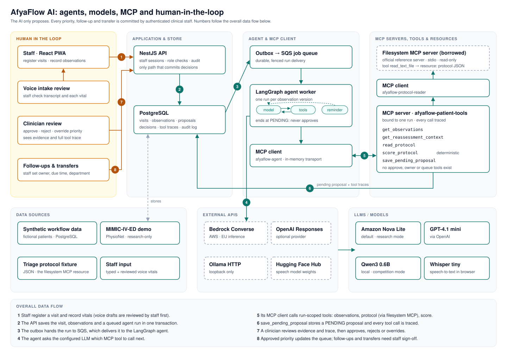
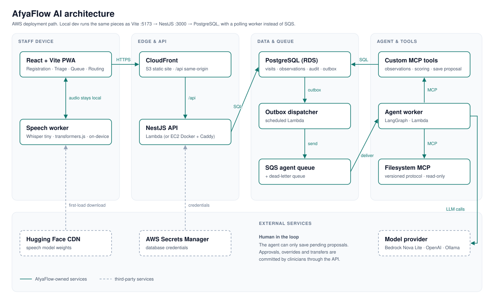

# AfyaFlow AI architecture

Status: a synthetic development slice is implemented. React talks to NestJS through
same-origin /api routes; PostgreSQL persists visits, immutable observations, jobs,
proposals, decisions, transfers, retry keys, sessions and audit events.

## Implemented runtime

Registration and observation writes queue durable assessment jobs. A leased worker
runs a LangGraph loop against the configured model provider, connects to run-scoped
custom MCP tools and retrieves the fixed test protocol through the official
filesystem MCP reference server. The graph stops at a persisted human-review state.
Only an authenticated clinical session can commit a separate approval transaction.
The model never receives an approval tool. Client staff IDs are not authority.

The provider is selected explicitly with `AI_PROVIDER` and recorded per run. Staging
uses OpenAI Responses (`gpt-4.1-mini`); Amazon Bedrock Converse (Nova Lite through an
EU inference profile) remains configurable; competition mode requires a local Ollama
model and a dedicated synthetic-only database. New and retried assessments are
capped per staff account and per deployment each hour to bound paid inference.
The scorer is a named unvalidated synthetic fixture, not an approved SATS protocol.
See specs/contracts.md and src/backend/README.md for implemented behavior.

**Active hosting:** a single EC2 host runs the app container, PostgreSQL and Caddy
(HTTPS) at afyaflow.online. GitHub Actions tests every push and deploys `main`
through AWS OIDC and Systems Manager; see deploy/ec2/README.md. Caddy supplies each
visitor's address to the app, which throttles sign-in and unlock per address and
failed PINs per staff account in shared PostgreSQL counters.

**Alternative, not the active deployment:** the Lambda configuration has separate
NestJS API, SQS worker, scheduled outbox dispatcher, and operator-only migration
entry points. Run creation and delivery intent share a PostgreSQL transaction;
worker leases and retry generations fence duplicate or old messages. The API
retains cookie sessions behind same-origin CloudFront routing; address throttling
there uses an authenticated CloudFront viewer address. The SAM template includes
private S3 frontend hosting and scoped function permissions, and uses an existing
private database and VPC service connectivity. Local polling is retained for
development. See deploy/lambda/README.md. SAM lint and local Lambda handler tests
are distinct from an actual Lambda deployment or container smoke test.

## Original design plan (not a claim of completed clinical validation)

## Application boundaries

The repository contains separate React + Vite and NestJS projects. src/frontend/src contains React pages, features and offline draft handling; src/backend/src contains NestJS feature modules, authentication and PostgreSQL access. NestJS will use TypeScript; the existing frontend uses JavaScript/JSX. src/shared/contracts holds browser-safe runtime schemas and types; cross-project packaging must be configured during implementation.

NestJS controllers handle HTTP boundaries and delegate to injectable services. Feature modules group controllers and providers. Authentication/authorisation guards and validation enforce reviewed contracts. Define the frontend API base URL and permitted origins during deployment planning; a same-origin reverse proxy is an option. Configure cookie/token and CSRF behaviour as part of the staff-session contract.

JecintaK owns all pages, UI features, frontend verification and PWA behaviour, using dedicated frontend feature branches. mson-wagz owns APIs, persistence, server-side staff access and clinical approvals. Mejja owns the TypeScript agent workflow and MCP integration. All three review contracts before implementation.

## Agent and MCP boundaries

services/agents will coordinate a LangGraph workflow using a locally served open-weights model. services/mcp will expose custom tools to retrieve observations, deterministically score a versioned protocol and save a pending recommendation. These tools must perform distinct operations rather than proxying one endpoint.

The proposed borrowed server is the official filesystem MCP reference server. It provides protocol-file retrieval without rebuilding generic filesystem access. Run it with approved resources mounted read-only and expose only necessary read tools to the agent. It must not access patient records, credentials or the rest of the repository.

The clinical protocol, supported population, model version, hardware, hosting location and service transport will be chosen during specification. No clinical scoring thresholds are defined by this scaffold.

## Approval and data flow

React + Vite PWA → authenticated NestJS controller → application service → PostgreSQL. Prisma remains a recommended database-access option pending the reviewed data-model plan.

Assessment request → agent → custom MCP observation retrieval → borrowed MCP protocol retrieval → deterministic scoring tool → validated pending recommendation → clinician review → server-side approval transaction.

The approval transaction checks the clinician's role and current observation version, records the decision and updates approved queue state atomically. Rejection, override and retry behaviour will be defined in the contracts. Agent credentials must never grant clinical approval authority.

## Connectivity and audit

The PWA will capture local drafts and show pending sync and stale queue indicators. Shared queue updates require server acknowledgement; offline operation retains a staff escalation path. Polling is the initial update mechanism.

Record tool inputs, outputs, timestamps, run IDs and evidence versions, linking them to the clinician's decision. Synthetic data is the development default. src/frontend/public contains only non-sensitive assets.

## Next specification work

Define requirements, entity versions, API/MCP schemas, authentication permissions, offline retention and evaluation fixtures before adding runtime code. This document will be updated to reflect implemented behaviour before submission.
